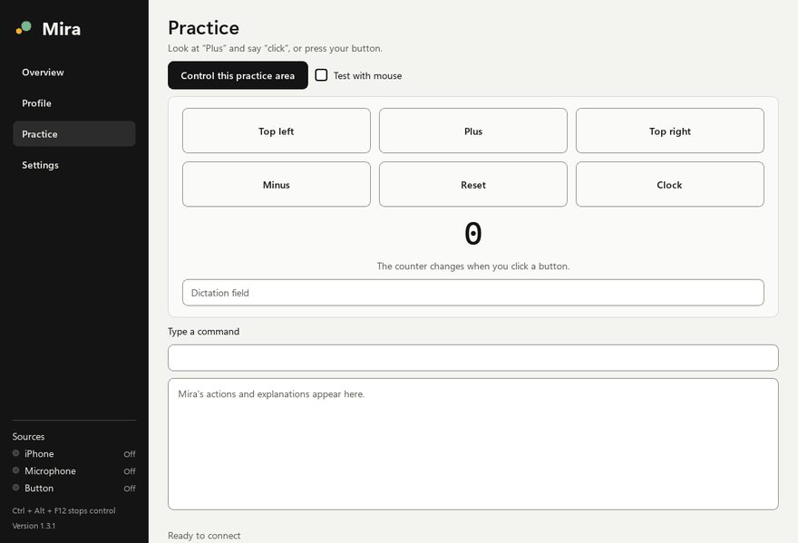
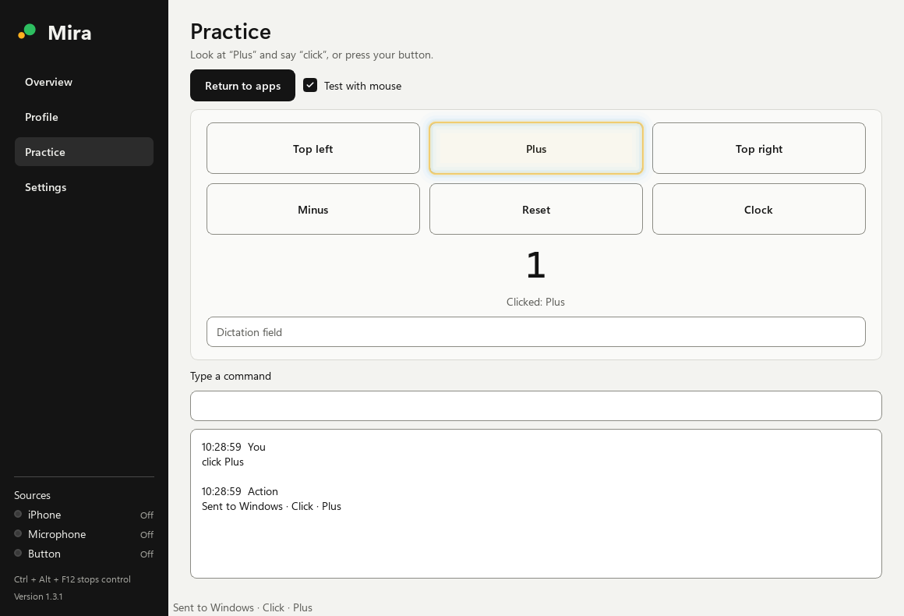

<p align="center">
  
</p>

<h1 align="center">Mira</h1>

<p align="center">
  <strong>Look at a Windows control and activate it by voice or with a button.</strong>
</p>

<p align="center">
  <a href="https://github.com/Xopoko/Mira/releases">Download for Windows</a> ·
  <a href="phone/README.md">Build the iPhone companion</a>
</p>

<p align="center">
  <a href="https://github.com/Xopoko/Mira/actions/workflows/ci.yml"></a>
</p>



The demo uses Mira's mouse preview and typed commands in an isolated Windows session.

Mira uses an iPhone's TrueDepth camera to estimate where you are looking and
Windows UI Automation to find controls. A highlight shows which control will
receive your next action. You can confirm with a spoken command, a bound USB
button, or optional dwell.

- Try the highlight and commands with a mouse and keyboard in **Practice**.
- Set up gaze for your screen and check it on separate targets before saving it.
- Use a calibrated webcam as a fallback when the iPhone briefly loses track.
- Pause control from **Overview** or with **Ctrl+Alt+F12**.

## Install on Windows

Use Windows x64 and 64-bit Python 3.11. Download the wheel and
`requirements.lock.txt` from [Releases](https://github.com/Xopoko/Mira/releases).
Run these commands in PowerShell from the download folder.

```powershell
py -3.11 -m venv .venv
.\.venv\Scripts\python.exe -m pip install -r requirements.lock.txt
.\.venv\Scripts\python.exe -m pip install --no-deps .\context_operator-1.3.1-py3-none-any.whl
.\.venv\Scripts\pythonw.exe -m context_operator.app
```

## Try it

Open **Practice** and turn on **Test with mouse**. Move the pointer near
**Plus** to see the target highlight. Enter `click Plus` in **Type a command**
and press **Enter**. The counter increases.



For eye tracking, [install the companion](phone/README.md) on a TrueDepth
iPhone running iOS 17 or later, then [connect it over Wi-Fi](docs/phone-wifi.md).
In **Overview**, select **Set up**. Look at each of the nine training targets
and five check targets, pressing **Space** when each ring fills. Select
**Use gaze setup** when Mira offers it. Repeat setup if you move the phone or
monitor or change your seated position.


Set up [local voice recognition](docs/models.md) to say `click`, or
[bind a USB button](docs/usb-button.md). You can also turn on dwell in
**Settings** to activate a control by holding your gaze. See the
[webcam guide](docs/webcam.md) for fallback setup.

## Build from source

```powershell
git clone https://github.com/Xopoko/Mira.git
cd Mira
py -3.11 -m venv .venv
.\.venv\Scripts\python.exe -m pip install -r requirements.lock.txt
.\.venv\Scripts\pythonw.exe launch.pyw
```

Run `.\.venv\Scripts\python.exe -m pip wheel --no-deps --wheel-dir dist .` to
build the desktop wheel. See [Development](docs/development.md) for desktop
tests and [iPhone checks](phone/README.md#checks) for the Xcode build and tests.

## How it fits together

`context_operator/core/` combines gaze with information about visible
controls and checks that a target is still current before dispatch.
`context_operator/providers/` connects the core to Windows, cameras and local
models. `context_operator/ui/` contains the Qt app and overlay.
`phone/` contains the Swift companion.
[Architecture](docs/architecture.md) explains setup, target selection and input.

## Privacy

- Voice recognition runs locally. Screen and camera frames stay in memory
  during ordinary use. Settings and numeric calibration data stay on the PC.
- The iPhone Wi-Fi stream carries numeric eye and head measurements without
  encryption or authentication. Use it on a trusted network.
- If you choose **Remote API (HTTPS)**, complex commands and screen context
  go to the endpoint you configure. With screen recognition enabled, context
  may include an image of the visible part of the current window. See
  [Voice and models](docs/models.md) for what the request contains.

## Contributing and license

[Contributing](CONTRIBUTING.md) · [Security](SECURITY.md) ·
[Changelog](CHANGELOG.md) · [MIT license](LICENSE)
