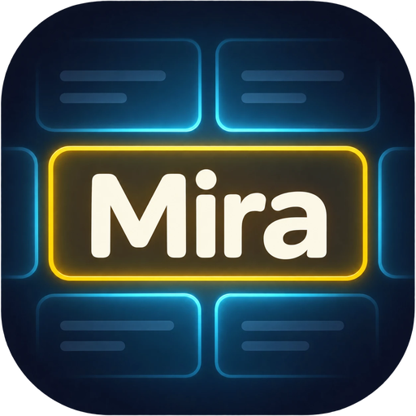
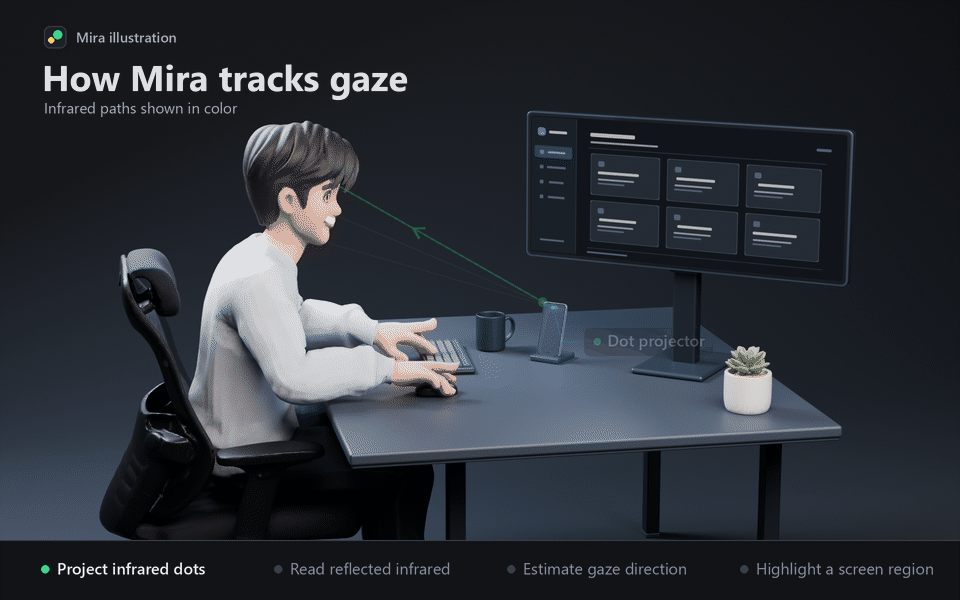
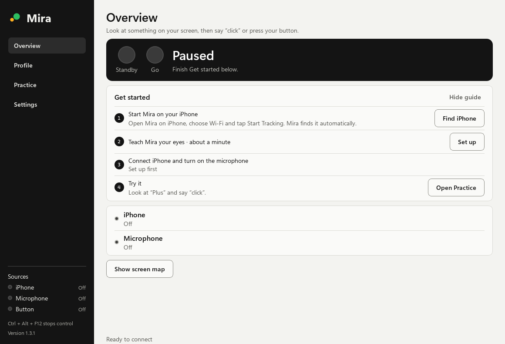

<p align="center">
  
</p>

<h1 align="center">Mira</h1>

<p align="center">
  <strong>See roughly where you’re looking on a Windows screen with an iPhone’s TrueDepth camera.</strong>
</p>

<p align="center">
  <a href="https://github.com/Xopoko/Mira/releases">Download for Windows</a> ·
  <a href="phone/README.md">Build the iPhone companion</a>
</p>

<p align="center">
  <a href="https://github.com/Xopoko/Mira/actions/workflows/ci.yml"></a>
</p>



Mira is a gaze-tracking prototype. The iPhone uses ARKit to measure eye
direction and head pose. After a personal calibration, the Windows app maps
those measurements to screen coordinates and lights up nearby interface
contours to show where it estimates you are looking.


Mira’s Windows overlay following simulated gaze samples.

<table>
  <tr>
    <th>Windows</th>
    <th>iPhone</th>
  </tr>
  <tr>
    <td></td>
    <td></td>
  </tr>
</table>

## Try gaze tracking

On Windows, choose **Try with mouse** in **Overview** to see how the
highlight moves before you connect an iPhone.

1. Install Mira on a TrueDepth iPhone running iOS 17 or later. Put the iPhone
   and PC on the same trusted network. Place the phone below the screen
   facing you, then tap **Start Tracking**. [iPhone installation](phone/README.md)
2. In **Overview** on Windows, select **Set up iPhone**, then **Connect iPhone**.
   Mira looks for your phone automatically over Wi-Fi. If it can’t find it,
   close setup and select **Connection settings** in **Overview**.
   [Manual connection](docs/phone-wifi.md#enter-the-address-manually)
3. Select **Start setup**. Look at each of the thirteen targets and press
   **Space** when its ring fills. Sit the way you usually do; turning your head
   toward a target is fine. Select **Check on new points**, do the same for
   five more targets, then select **Use gaze setup** if offered. Mira works out
   where the screen is from these points, so you don’t enter the monitor size
   or the phone’s position.
4. Back in **Overview**, select **Connect iPhone**. Once gaze tracking is
   live, **Live preview** shows a miniature of your screen with the same
   highlight. Select **Open Practice**. In the default **Follow gaze** mode,
   the dot and nearby contours move as you look around. Choose
   **Stop practice** to try the overlay in other apps. **Ctrl+Alt+F12** pauses
   tracking.

Mira is most useful for broad areas such as panels and large controls.
**Overview** and **Calibration → Details** show the setup check: **Typical error** (median)
and **Hard points** (90th percentile) in physical screen pixels. The check uses targets that
were held out of calibration. Repeat setup if you move the phone or monitor
or change where you sit.

A [calibrated webcam](docs/webcam.md) can take over briefly when the
iPhone loses track. [Local voice commands](docs/models.md) and dwell
activation are optional.

## How it works

TrueDepth projects an infrared dot pattern onto the face. The infrared camera
reads the reflected pattern to measure depth. The illustration above slows
down both paths so you can see their direction. [Apple’s TrueDepth overview](https://support.apple.com/en-us/102381)

The seated figure and curved monitor are CC0.
[Innerscene figure](https://www.innerscene.com/tools/library/3d-parts/seated-office-figure-79182d38) ·
[3D Assets monitor](https://3dassets.dev/assets/computers-and-desk-gadgets-monitor-34-curved-bc2883cf).
The iPhone 15 Pro Max model by polyman Studio was adapted for the illustration.
[Original model](https://sketchfab.com/3d-models/apple-iphone-15-pro-max-black-df17520841214c1792fb8a44c6783ee7) ·
[CC BY 4.0](https://creativecommons.org/licenses/by/4.0/).

- `phone/` reads eye and head measurements from ARKit and serves them over Wi-Fi.
- `context_operator/personalization/` fits and checks the screen mapping.
- `context_operator/core/` and `context_operator/ui/` combine projected gaze
  with visible interface geometry and draw the overlay.

See [Architecture](docs/architecture.md) for coordinates, calibration and
how Mira handles stale observations.

## Install on Windows

Use Windows x64 and 64-bit Python 3.11. This page describes the current
source: the thirteen-point setup and the Practice layout shown above come with
a [build from source](#build-from-source). The published release is older and
has [its own instructions](https://github.com/Xopoko/Mira/blob/v1.3.1/README.md).
To install it, download the wheel and `requirements.lock.txt`
from [Releases](https://github.com/Xopoko/Mira/releases), then run these
commands in PowerShell from the download folder.

```powershell
py -3.11 -m venv .venv
.\.venv\Scripts\python.exe -m pip install -r requirements.lock.txt
.\.venv\Scripts\python.exe -m pip install --no-deps .\context_operator-1.3.1-py3-none-any.whl
.\.venv\Scripts\pythonw.exe -m context_operator.app
```

## Build from source

```powershell
git clone https://github.com/Xopoko/Mira.git
cd Mira
py -3.11 -m venv .venv
.\.venv\Scripts\python.exe -m pip install -r requirements.lock.txt
.\.venv\Scripts\pythonw.exe launch.pyw
```

Run `.\.venv\Scripts\python.exe -m pip wheel --no-deps --wheel-dir dist .` to
build the desktop wheel. See [Development](docs/development.md) for desktop
tests and [iPhone checks](phone/README.md#checks) for the Xcode build and tests.

## Privacy

- The iPhone sends numeric eye and head measurements, never images. Use a
  trusted network because the Wi-Fi stream has no authentication or
  encryption.
- Calibration data and settings stay on the PC. Voice recognition runs
  locally. Screen and camera frames stay in memory during ordinary use.
- If you enable **Remote API (HTTPS)**, complex commands and screen context
  go to the endpoint you configure. With screen recognition enabled, context
  may include an image of the visible part of the current window.
  See [Voice and models](docs/models.md).

## Contributing and license

[Contributing](CONTRIBUTING.md) · [Security](SECURITY.md) ·
[Changelog](CHANGELOG.md) · [MIT license](LICENSE)
