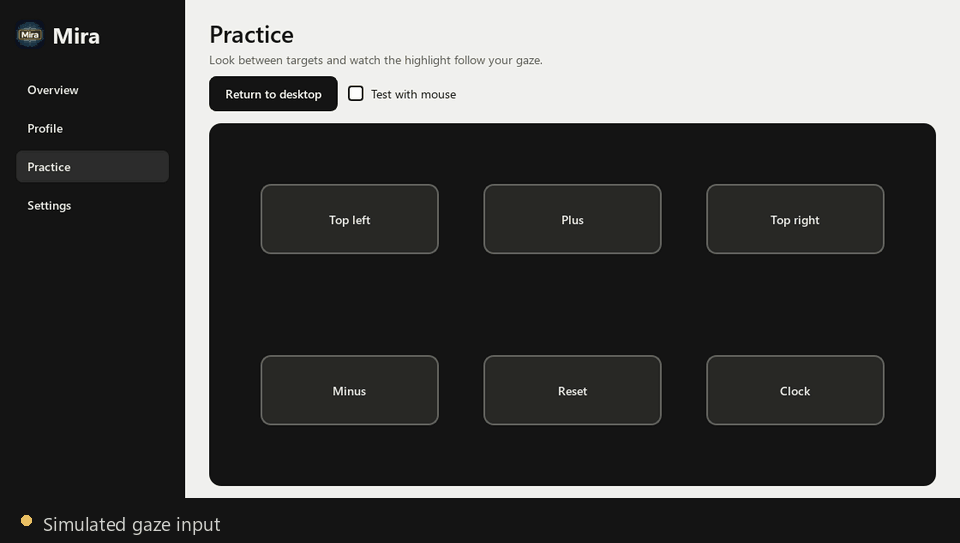
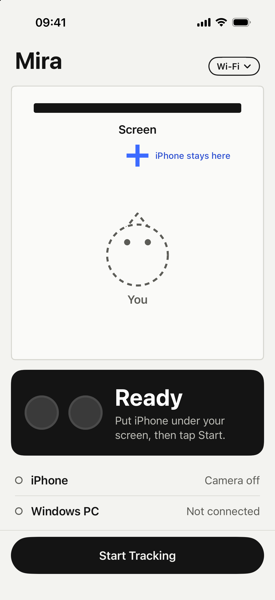

<p align="center">
  
</p>

<h1 align="center">Mira</h1>

<p align="center">
  <strong>See roughly where you’re looking on a Windows screen with an iPhone’s TrueDepth camera.</strong>
</p>

<p align="center">
  <a href="https://github.com/Xopoko/Mira/releases">Download for Windows</a> ·
  <a href="phone/README.md">Build the iPhone companion</a>
</p>

<p align="center">
  <a href="https://github.com/Xopoko/Mira/actions/workflows/ci.yml"></a>
</p>


Mira is a gaze-tracking prototype. The iPhone uses ARKit to measure eye
direction and head pose. After a personal calibration, the Windows app maps
those measurements to screen coordinates and lights up nearby interface
contours. The result is an estimate of which region has your attention.



Mira’s Windows overlay following simulated gaze samples.

<table>
  <tr>
    <th>Windows</th>
    <th>iPhone</th>
  </tr>
  <tr>
    <td></td>
    <td></td>
  </tr>
</table>

## Try gaze tracking

1. [Install the companion](phone/README.md) on a TrueDepth iPhone running
   iOS 17 or later. Place it below the screen facing you, then tap
   **Start Tracking**.
2. Put the iPhone and PC on the same trusted network. In the Windows app,
   open **Overview** and select **Find iPhone**. See the
   [Wi-Fi guide](docs/phone-wifi.md) for manual connection.
3. Select **Set up**. Look at each of the nine training targets and five
   check targets. Press **Space** when each ring fills, then select
   **Use gaze setup** if offered.
4. Select **Connect iPhone**, then **Open Practice**. In the default
   **Follow gaze** mode, the dot and nearby contours move as you look around.
   Choose **Return to desktop** to try the overlay in other apps.
   **Ctrl+Alt+F12** pauses tracking.

Mira is most useful for broad areas such as panels and large controls.
In **Profile → Details**, the setup check shows **Typical error** (median)
and **Hard points** (90th percentile) in physical screen pixels. The check uses targets that
were held out of calibration. Repeat setup if you move the phone or monitor
or change where you sit.

You can preview the contours with **Practice → Test with mouse**. A
[calibrated webcam](docs/webcam.md) can take over briefly when the iPhone
loses track. [Local voice commands](docs/models.md) and dwell activation
are optional.

## How it works

TrueDepth projects an infrared dot pattern onto the face. The infrared camera
reads the reflected pattern to measure depth. The illustration above slows
down both paths so you can see their direction. [Apple’s TrueDepth overview](https://support.apple.com/en-us/102381)

The seated figure and curved monitor are CC0.
[Innerscene figure](https://www.innerscene.com/tools/library/3d-parts/seated-office-figure-79182d38) ·
[3D Assets monitor](https://3dassets.dev/assets/computers-and-desk-gadgets-monitor-34-curved-bc2883cf).
The iPhone 15 Pro Max model by polyman Studio was adapted for the illustration.
[Original model](https://sketchfab.com/3d-models/apple-iphone-15-pro-max-black-df17520841214c1792fb8a44c6783ee7) ·
[CC BY 4.0](https://creativecommons.org/licenses/by/4.0/).

- `phone/` reads eye and head measurements from ARKit and serves them over Wi-Fi.
- `context_operator/personalization/` fits and checks the screen mapping.
- `context_operator/core/` and `context_operator/ui/` combine projected gaze
  with visible interface geometry and draw the overlay.

See [Architecture](docs/architecture.md) for coordinates, calibration and
how Mira handles stale observations.

## Install on Windows

Use Windows x64 and 64-bit Python 3.11. The Practice layout shown above is
available when you [build from source](#build-from-source). To install the
latest published release, download the wheel and `requirements.lock.txt`
from [Releases](https://github.com/Xopoko/Mira/releases), then run these
commands in PowerShell from the download folder.

```powershell
py -3.11 -m venv .venv
.\.venv\Scripts\python.exe -m pip install -r requirements.lock.txt
.\.venv\Scripts\python.exe -m pip install --no-deps .\context_operator-1.3.1-py3-none-any.whl
.\.venv\Scripts\pythonw.exe -m context_operator.app
```

## Build from source

```powershell
git clone https://github.com/Xopoko/Mira.git
cd Mira
py -3.11 -m venv .venv
.\.venv\Scripts\python.exe -m pip install -r requirements.lock.txt
.\.venv\Scripts\pythonw.exe launch.pyw
```

Run `.\.venv\Scripts\python.exe -m pip wheel --no-deps --wheel-dir dist .` to
build the desktop wheel. See [Development](docs/development.md) for desktop
tests and [iPhone checks](phone/README.md#checks) for the Xcode build and tests.

## Privacy

- Over Wi-Fi, the iPhone sends numeric eye and head measurements. Use a
  trusted network because this stream has no authentication or encryption.
- Calibration data and settings stay on the PC. Voice recognition runs
  locally. Screen and camera frames stay in memory during ordinary use.
- If you enable **Remote API (HTTPS)**, complex commands and screen context
  go to the endpoint you configure. With screen recognition enabled, context
  may include an image of the visible part of the current window.
  See [Voice and models](docs/models.md).

## Contributing and license

[Contributing](CONTRIBUTING.md) · [Security](SECURITY.md) ·
[Changelog](CHANGELOG.md) · [MIT license](LICENSE)
