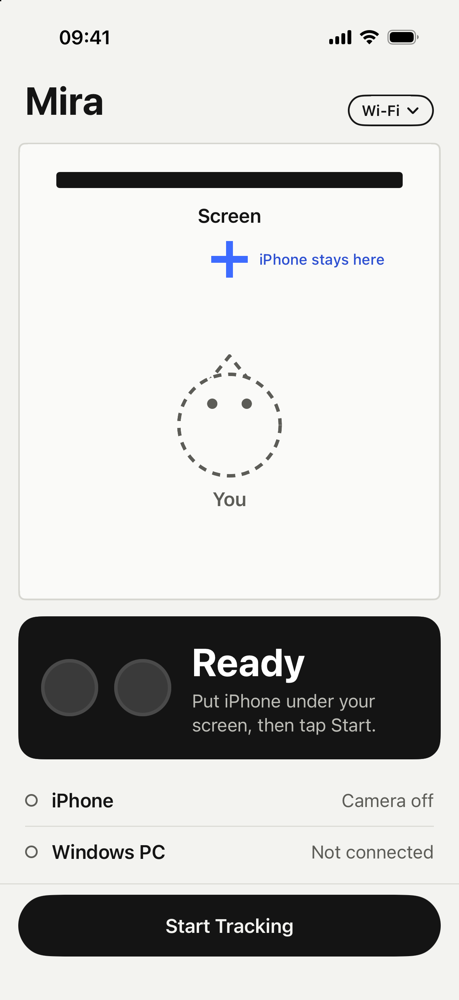

# Mira for iPhone

Mira uses the iPhone's TrueDepth camera to measure your eyes and head pose.
The Windows app uses those measurements to estimate where you are looking.
Build and install the companion on a TrueDepth iPhone running iOS 17 or later.



## Build and install

On macOS, install Xcode and XcodeGen. From the repository root, run these
commands.

```sh
cd phone
xcodegen generate
open MyEyeTrackingPhone.xcodeproj
```

In Xcode, select the **MyEyeTrackingPhone** application target. Under
**Signing & Capabilities**, choose your own development team with automatic
signing. If your team requires a different bundle identifier, update
`PRODUCT_BUNDLE_IDENTIFIER` in `phone/project.yml` and regenerate the project.
Select your connected iPhone and run the app.

Follow the [Windows connection guide](../docs/phone-wifi.md) once the app is
installed. The first tracking session may request camera and local network
access.

## Connection and data

The app sends numeric measurements only. Wi-Fi is the default for new
installs and serves them on TCP port `39472` over the private local network.
The [Wi-Fi guide](../docs/phone-wifi.md) describes the connection and its
limits.

USB needs a separate USB bridge on Windows, which this repository does not
include. Set `MIRA_IPHONE_USB_BRIDGE` to the path of the bridge's Python
adapter. The adapter must export `open_stream()` and the `USBError` exception
it raises. On the phone, USB uses a loopback listener on port `39471`. Stop or
backgrounding closes the active listener and stops ARKit.

## Checks

From the repository root on macOS, the following checks run without signing,
an iPhone or camera access.

```sh
python3 scripts/check_phone_build.py
python3 scripts/check_phone_native.py
```

To run the Swift unit tests in the simulator, use the same scheme as CI.

```sh
cd phone
xcodegen generate
xcodebuild test -scheme MyEyeTrackingPhone \
  -destination 'platform=iOS Simulator,name=iPhone 17,OS=latest' \
  -parallel-testing-enabled NO CODE_SIGNING_ALLOWED=NO
```

Replace `iPhone 17` with the name of an installed simulator as needed.
